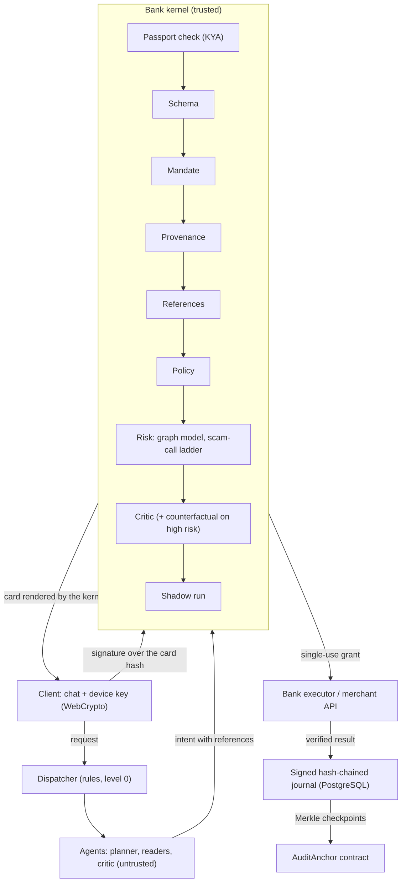

# Guardian

**An AI assistant in the banking app that finishes money tasks for the client — and a kernel that lets it do exactly what the client signed, not a cent more.**

2026 Shenzhen FinTechathon · International Track · Topic A: Personal Finance Assistant · Theme: *AI as a Financial Participant*

> Finding money leaks is easy. Fixing them is risky. We make fixing them safe — and cheap enough to run for millions of clients.

## Promises

1. **The agent finishes the job.** It finds the problem, asks once, executes, and checks the result with the bank or the merchant.
2. **The agent can do exactly what you confirmed.** Payee, amount, period, money source, merchant. Nothing more.
3. **You never give the agent passwords or card numbers.** Only the bank kernel sees them.
4. **Repeat tasks are almost free.** The first run uses a capable model; repeats come from a saved template with no model at all.

## Results

All numbers come from `make evidence` and the test suite on the synthetic demo bank (seed 22, 1 156 transactions, 17 Oct 2026 10:00 MSK).

| What | Result | Source |
|---|---|---|
| Functional evaluation set, scenarios C1–C10, EN/RU/ZH | **48 / 48** tasks | `evidence/eval_report.json` |
| Attacks in the evaluation set (static, retention, adaptive goals) | **50 / 50** stopped | `evidence/eval_report.json` |
| Static red-team: compromised agent with a valid passport | **39 / 39** stopped, 0 ₽ lost; without the kernel 39 / 39 succeed, 532 038.76 ₽ lost | `evidence/redteam.json` |
| Retention tricks during cancellation (discount, upsell, wrong card…) | **5 / 5** stopped | `evidence/redteam.json` |
| Adaptive attacker (mutation search, 10 rounds × 6 tries × 6 goals) | **0 / 360** attempts went outside the mandate; without the kernel all 6 goals are reached on the first try | `evidence/redteam.json` |
| Earlier prototype's suite, replayed | 20 / 21 prevented, 1 bounded by limits | `evidence/redteam.json` |
| Subscription leaks planted / found | 5 / 5, 0 extra (847 ₽ a month, 10 164 ₽ a year) | `evidence/budget_report.json` |
| Double charge planted / found | 1 / 1 | `evidence/budget_report.json` |
| Cash gap caught in time on the held-out months | 1 / 1, 0 false alarms in 18 probes | `evidence/budget_report.json` |
| Spending forecast, held-out months Jul–Sep | WAPE 27.3 % overall; bills 4.3 %, subscriptions 1.3 % | `evidence/budget_report.json` |
| Payee risk on the transfer graph (held-out synthetic graphs) | ROC-AUC 1.0, precision 0.993, recall 0.944, 0 false positives on employers, merchants and landlords | `evidence/risk_graph.json` |
| Journal anchoring (local devnet) | 4 checkpoints; a rewritten-and-rehashed entry and a cut tail are both detected | `evidence/anchors.json` |
| Model cost of one client's month (estimate on real prompts, stub answers) | first month 0.73 ₽, next month 0.27 ₽ (−63 %); a repeat payment uses no model; ≈ 270 000 ₽ a month per million clients | `evidence/costs.json` |
| Automated tests | 324 passed; 9 PostgreSQL tests run with `make test-pg` | `make test` |

The graph model is trained and tested on graphs from our own generator. Real bank data will score lower: the numbers show the pipeline works, not field accuracy.

## What it does

| # | Scenario | What the client sees |
|---|---|---|
| C1 | "Pay for Melodify" | A kernel card with the real payee, amount and source; one tap; next month it happens alone inside the permission |
| C2 | "Cancel the 399 ₽ subscription" | The kernel picks the right merchant account, signs in with credentials from the bank vault (the agent never sees them), cancels via the merchant's API and checks three sources |
| C3 | Find subscription leaks | Unused, duplicate and price-raised subscriptions with the sum per month and per year |
| C4 | Double charge | Dispute opened after one confirmation |
| C5 | Pay bills | Every bill checked against the bank's payee directory and the client's history |
| C6 | Fake bill | Look-alike sender, wrong account, pressure words, hidden text for AI agents: a case file instead of a payment |
| C7 | Free trial | Warning before the first charge; cancel or keep |
| C8 | Budget, envelopes, goals | Auto-budget, safe-to-spend today, cash-gap warning with a fix, salary split, "can I afford it", goals, month review, forecast accuracy |
| C9 | "Safe account" scam call | Four-level ladder: warning, pause, 24-hour reversible hold, live analyst; duress PIN; elevated protection for the elderly |
| C10 | Payee risk on the transfer graph | Mule-ring features and a gradient-boosting model as one more kernel check |

## How it is built



- **Agents only propose.** Every intent goes through a deterministic pipeline: passport, schema, mandate, provenance of each field, reference check, policy, risk, critic, shadow run.
- **What you see is what you sign.** The card is rendered by the kernel, not the model. The device signs the hash of that card. Execution uses a single-use grant bound to that hash.
- **Provenance.** Every field carries a CLIENT, BANK or UNTRUSTED label. Money can move only to payees and amounts that come from the client or the bank, never from a document or a model.
- **Earned trust.** Each kind of task climbs from level 0 (a card for everything) after 5 verified results in a row. Any mistake drops it a level; a scope violation drops it to 0.
- **Model ladder.** Level 0 is rules and templates, level 1 a small model (readers, critic), level 2 a capable model (planner). A hard 2 000 ₽ cap is enforced by the kernel's LLM gateway; secrets are filtered out of every prompt.
- **Journal.** Signed and hash-chained. In PostgreSQL it is append-only: a trigger accepts only the next link, and the app role works under row-level security. Merkle checkpoints are anchored by `chain/src/AuditAnchor.sol`.

Compliance with 智能体支付应用自律公约 (Payment & Clearing Association of China, 2026) and the mapping to Mastercard Verifiable Intent and Google AP2 are in the app's **Compliance** section and in the security report.

## Quick start

```bash
docker compose up --build      # http://localhost:8000 — replay mode, PostgreSQL, no API keys needed
```

The image runs the whole test suite at build time. Without Docker (Python 3.14):

```bash
make install       # pinned requirements + Chromium for the UI tests
make test          # unit, end-to-end, red-team, evaluation
make run           # http://localhost:8000
make evidence      # regenerates the numbers above
make anchor        # anchors the journal on a local anvil devnet (needs Foundry)
GUARDIAN_TEST_PG=postgresql://…/empty_db make test-pg
```

Modes (`GUARDIAN_LLM_MODE`): `replay` (default) replays recorded model runs and falls back to deterministic stubs when no recording exists; `stub` is for tests; `live` and `record` need `ANTHROPIC_API_KEY` in `.env` (see `.env.example`).

The app has twelve sections: Month for you, Payments, Budget, Permissions, Trust, Agents at work, Cost, Security, Red-team, Compliance, Inbox, Journal. Demo buttons in the header move the demo clock and simulate a scam call.

## Repository layout

| Path | Contents |
|---|---|
| `kernel/` | Trusted kernel: passports, mandates, pipeline, provenance, references, policy, critic, counterfactual check, trust, budget, cancellations, secret vault, journal, LLM gateway, PostgreSQL store |
| `agents/` | Untrusted agents: dispatcher, planner, readers |
| `app/` | Chat service and web API; `app/sections.py` feeds the side sections |
| `web/` | Chat UI with kernel-rendered cards and the device key |
| `sandbox/` | Sandbox bank and merchant accounts with their APIs |
| `data/` | Synthetic demo world generator |
| `risk_graph/` | Transfer-graph generator, features and model |
| `redteam/` | Attack harness, static and retention attacks, adaptive attacker |
| `evalset/` | Functional evaluation tasks |
| `chain/` | `AuditAnchor` contract (Foundry), tests and the anchoring client |
| `db/` | SQL migrations: schema, row-level security, append-only journal |
| `tests/` | Unit, end-to-end (incl. Chromium), integration, red-team and evaluation suites |
| `evidence/` | Generated reports, journal demo, anchors |
| `guardian/` | The earlier prototype, kept for the replayed attack suite |

All data is synthetic. Brands (`Melodify`, `StreamBox`, `CloudNest`) and people are fictional; domains use the reserved `.example` TLD.

## License

MIT, see `LICENSE`. Third-party packages: `THIRD_PARTY_NOTICES.md`.
