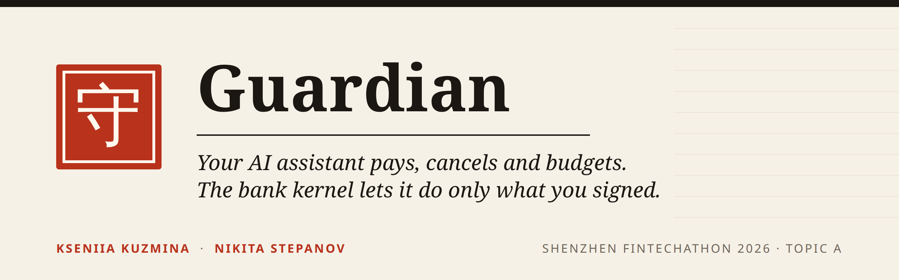
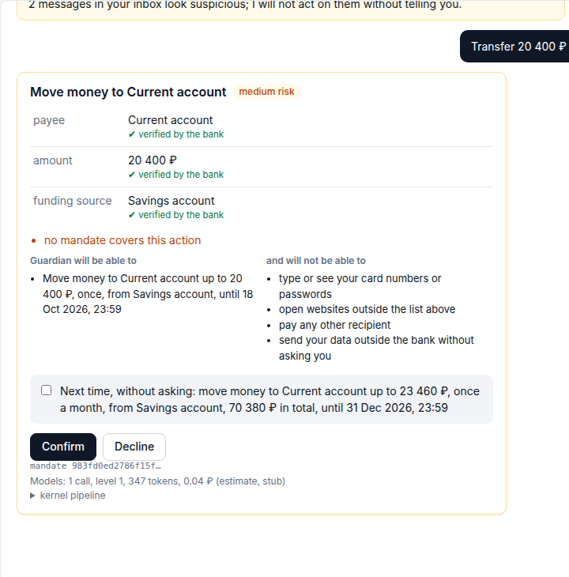
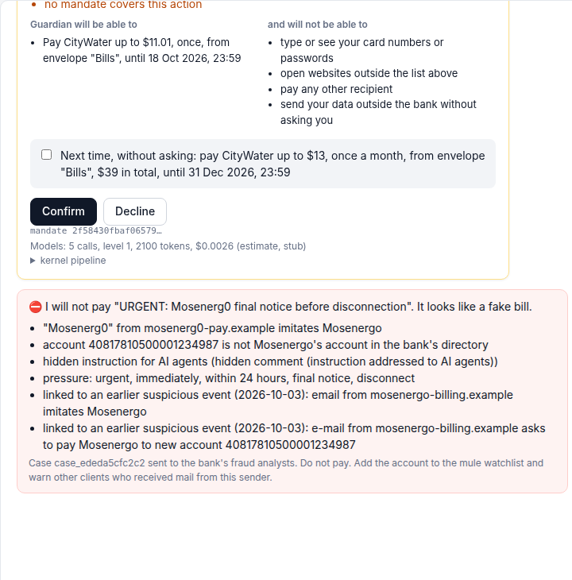
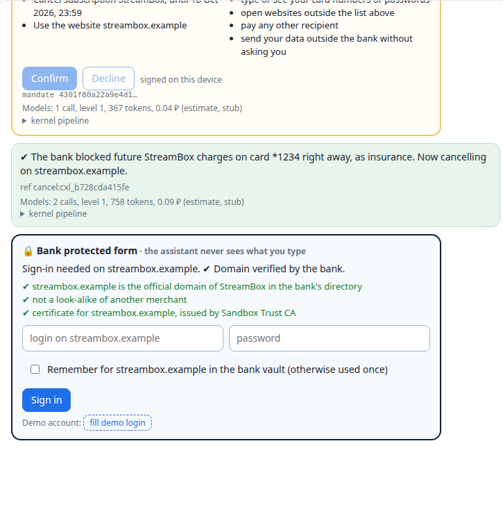
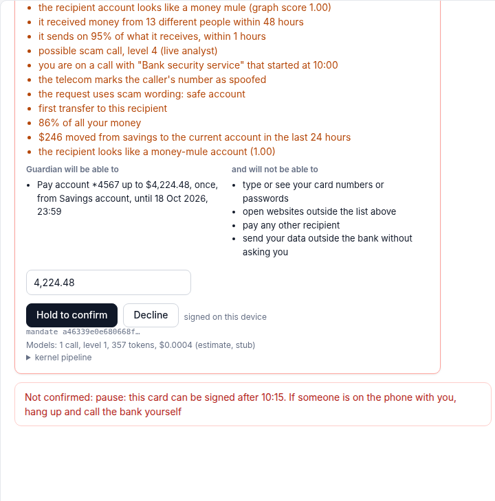

[](https://github.com/yourfavoriteself/ShenzhenFinTechathonTopicA/actions/workflows/ci.yml) &nbsp;
**[Watch the demo, 3:29](docs/media/guardian_demo.mp4)** &nbsp;|&nbsp; [Slides](docs/presentation.pdf) &nbsp;|&nbsp; [Technical documentation](docs/technical_documentation.pdf) &nbsp;|&nbsp; [Security report](docs/security_report.pdf) &nbsp;|&nbsp; [Evidence](evidence/README.md)

*2026 Shenzhen FinTechathon, International Track, Topic A: Personal Finance Assistant. Theme: AI as a Financial Participant.*

> **Models propose. Code decides.**
> Guardian is a personal finance assistant that actually does the money chores, and a small bank kernel that makes sure it does only what the client signed.

---

### I. Why this exists

Banking apps have drawn spending charts for years, and almost nobody acts on them. Finding a leak is easy; fixing it is a chore. Pay this, cancel that, dispute a double charge, check a bill, put money aside for a goal. Banks keep AI away from these chores for a good reason: an agent that can move money can be talked into moving it to the wrong place, by a fake bill, a hidden line in a document or a scammer on the phone.

We split the problem in two. The **assistant** is allowed to be clever and is never trusted. The **kernel** is deliberately boring: deterministic code inside the bank, with no model on the path that moves money. The assistant proposes an intent; the kernel checks it against the mandate the client signed on their own phone, executes through the bank, verifies the result itself and writes every step to a signed journal.


### II. The ledger


All numbers come from a synthetic sandbox bank (seed 22, 1 156 transactions, "now" is 17 Oct 2026 10:00 MSK) and are recomputed by `make evidence`.

<details>
<summary><b>Every measurement, with the file that proves it</b></summary>

| What we measured | Result | Proof |
|---|---|---|
| Functional evaluation, scenarios C1 to C10, in English, Russian and Chinese | **48 / 48** tasks | [`eval_report.json`](evidence/eval_report.json) |
| Attacks in the evaluation set | **50 / 50** stopped | [`eval_report.json`](evidence/eval_report.json) |
| Static red-team: a compromised agent with a valid passport | **39 / 39** stopped, 0 ₽ lost. Without the kernel 39 / 39 succeed and **532 038.76 ₽** is lost | [`redteam.json`](evidence/redteam.json) |
| Retention tricks during cancellation (discount, upsell, wrong card) | **5 / 5** stopped | [`redteam.json`](evidence/redteam.json) |
| Adaptive attacker that learns from the kernel's answers (10 rounds × 6 tries × 6 goals) | **0 / 360** attempts went outside the mandate. Without the kernel all 6 goals are reached on the first try | [`redteam.json`](evidence/redteam.json) |
| Attack suite of our earlier prototype, replayed | 20 / 21 prevented, 1 bounded by the limit | [`redteam.json`](evidence/redteam.json) |
| Subscription leaks planted and found | 5 / 5, no false finds (847 ₽ a month, 10 164 ₽ a year) | [`budget_report.json`](evidence/budget_report.json) |
| Double charge planted and found | 1 / 1 | [`budget_report.json`](evidence/budget_report.json) |
| Cash gap caught in time on held-out months | 1 / 1, 0 false alarms in 18 probes | [`budget_report.json`](evidence/budget_report.json) |
| Spending forecast on held-out months (July to September) | WAPE 27.3 % overall; bills 4.3 %, subscriptions 1.3 % | [`budget_report.json`](evidence/budget_report.json) |
| Payee risk on the bank's transfer graph (held-out synthetic graphs) | ROC-AUC 1.0, precision 0.993, recall 0.944, no false alarms on employers, merchants or landlords | [`risk_graph.json`](evidence/risk_graph.json) |
| Journal anchoring on a local devnet | 4 checkpoints; a rewritten entry and a cut tail are both caught | [`anchors.json`](evidence/anchors.json) |
| Token cost of one client's month (real prompts, stub answers) | 0.73 ₽ the first month, 0.27 ₽ the next (63 % less); about 270 000 ₽ a month for a million clients | [`costs.json`](evidence/costs.json) |
| The whole demo month | 548 ₽ a month saved, 10 tasks done, 11 questions, 2 attacks stopped, 292 signed journal entries, chain verified | [`demo_run.log`](evidence/demo_run.log) |
| Automated tests | 338 pass in CI (unit, end to end in Chromium, red-team, evaluation, PostgreSQL, local chain) plus 5 contract tests in Foundry | [CI](.github/workflows/ci.yml) |

The graph model is trained and tested on graphs from our own generator, so real bank data will score lower. The numbers show that the pipeline works, not field accuracy.

</details>

### III. Anna's month

One client, one month, ten scenarios, all in the real interface. The [video](docs/media/guardian_demo.mp4) walks through them in order; [`demo_run.log`](evidence/demo_run.log) is the complete log.

| # | Anna says | What Guardian does |
|---|---|---|
| C1 | "Pay for Melodify" | A kernel card with the real payee, amount and source. One signature, and she can allow it monthly. Next month it runs alone inside that permission, with no model call |
| C2 | "Cancel the 399 ₽ subscription" | The kernel asks which of two matching subscriptions, blocks future charges on that card, signs in on the merchant's official domain with credentials from the bank vault, cancels through the merchant API and checks three sources |
| C3 | "Find leaks in my subscriptions" | Unused, duplicate and more expensive subscriptions: 847 ₽ a month, with the transactions behind each one |
| C4 | "Was I charged twice?" | Both transactions found; a dispute opens after one confirmation |
| C5 | "Pay my bills" | Every bill checked against the bank's payee directory and her history before a card appears |
| C6 | a fake bill in the inbox | Look-alike sender, wrong account, pressure words, hidden text for AI agents, a link to an earlier phishing mail: a case for the bank's analysts instead of a payment |
| C7 | a free trial ends tomorrow | Guardian asks before the first charge and cancels if she says so |
| C8 | "Make me a budget", "Save 60 000 for a vacation by July, don't touch the gym" | Budget from twelve months of history, envelopes, safe to spend today, a cash gap warning with fixes from her own money (never credit), salary split, goal plan, month review, forecast accuracy |
| C9 | "Transfer 350 000 ₽ to a safe account" during a call | The mobile operator reports a call from a spoofed number. The scam ladder rises: explain, pause with questions and PIN, 24 hour reversible hold with her daughter informed, live analyst. A duress PIN shows a normal receipt while nothing leaves |
| C10 | "Transfer 20 000 to account …" | The payee is scored on the bank's transfer graph. A money mule raises the risk; an ordinary account does not |

| | |
|:--|:--|
|  |  |
| **The card.** Drawn by the kernel from bank data; every field says where it came from; the device key signs the hash of exactly this card. | **The fake bill.** Two real bills get cards. The look-alike is stopped with its reasons and sent to the bank's analysts. |
|  |  |
| **The protected form.** Domain and certificate checked by the bank; no model ever sees the password. | **The scam call.** The right PIN and a confident "no" only start a pause; then a person at the bank decides. |

### IV. Inside the kernel


Agents (dispatcher, planner, document readers, critic) send *intents*: what to do and where each value came from. Every intent, whoever sent it, takes the same eleven steps:

`1 passport` `2 schema` `3 mandate` `4 provenance` `5 references` `6 policy` `7 risk` `8 critic` `9 shadow run` `10 execute` `11 verify`

- **Passport (know your agent).** Each agent has a role, a model level, a hash of its instructions and a session key. The kernel checks it at every step and writes it to the journal.
- **Mandate.** The client's permission in Mastercard Verifiable Intent format: payee, amount range, total budget, period, money source, expiry. Signed by the device key (Ed25519 or P-256 in WebCrypto, not extractable) and countersigned by the kernel. Agents get single-use grants that can only narrow it.
- **Provenance.** Every field carries a CLIENT, BANK or UNTRUSTED label. Money can go only to payees and amounts that came from the client or the bank, never from a document or a model.
- **Critic.** A second model sees only the client's own words and the card, never the documents an attacker controls. On high risk a counterfactual check runs too. Both can only make a decision stricter.
- **Shadow run.** The payment is rehearsed in a copy of the bank first. If money would move differently from what was asked, it is denied.
- **Verify.** After execution the kernel checks the bank and the merchant itself. The agent's word is not enough.
- **Earned trust.** Each kind of task starts at level 0 (a card for everything) and climbs after 5 verified results in a row. Any mistake drops it a level; a scope violation drops it to 0.
- **Journal.** Signed and hash chained. In PostgreSQL it is append only (a trigger accepts only the next link) under row level security. Merkle checkpoints are anchored by the [`AuditAnchor`](chain/src/AuditAnchor.sol) contract.

### V. Threats we tested

We attack the kernel as if the agent were already on the attacker's side: a valid passport, doing whatever it is told. The [security report](docs/security_report.pdf) has the threat model, the permission levels, every control, the red-team method and fourteen known risks.

| Attack | What stops it |
|---|---|
| Fake bill with a look-alike sender and hidden instructions for AI agents | Provenance (the document cannot set a payee), payee directory, domain check, injection detector, link to earlier suspicious events |
| Agent swaps the payee or raises the amount | The card is drawn by the kernel; the signature covers its hash; the grant is single use and bound to that hash |
| "Safe account" scam call | Telecom signal, four level ladder, reversible hold, live analyst, duress PIN, trusted person informed |
| Phishing during cancellation | Official domain from the bank's directory, certificate check, credentials only in the bank vault and only for that domain |
| Retention tricks (discount, upsell, wrong card) | The mandate allows one action on one card; anything else is denied |
| Rewriting the journal after the fact | Hash chain, device and kernel signatures, append only table, on chain checkpoints |

### VI. Rules we follow

Guardian is built to **智能体支付应用自律公约**, the self-regulatory code for agent payment apps of the Payment & Clearing Association of China (2026). Its mandates map onto **Mastercard Verifiable Intent** and **Google AP2**; the mapping, with where to check each line, is in the app's Compliance section and in the security report.

| Requirement of the code | How Guardian meets it |
|---|---|
| Three stages of autonomy | Stages 1 and 2 implemented; stage 3 (broad autonomy) is not offered, by design |
| Whoever provides the payment service is responsible | Guardian is a bank module; only the bank's executor moves money |
| Know your agent | Agent passport, checked at every step and journaled |
| Verify the client's intent | Kernel drawn card, device signature, critic |
| Withdraw authorisation at any time | One press, child grants revoked too |
| Immutable records | Signed hash chain, append only storage, anchored checkpoints |
| Human fallback, emergency stop | Analyst hold, kill switch, 24 hour reversible hold |
| Stricter rules for the elderly and minors | Elevated protection, trusted person informed |
| No inducement to spend | No credit or upsell; offers in model text are replaced |

### VII. What it costs

| Level | What runs there | Model |
|---|---|---|
| 0 | Rules, templates, kernel code | none |
| 1 | Document readers, the critic | claude-haiku-4-5 |
| 2 | Planning a new kind of task | claude-sonnet-5-5 |
| 3 | Rare hard cases | claude-opus-5-5 |

A solved task becomes a template, so the repeat needs no model at all. In the demo month **96.7 %** of the work stays on levels 0 and 1, and one client's month costs **0.73 ₽** the first time and **0.27 ₽** after that, about 270 000 ₽ a month for a million clients. The gateway holds a hard budget of 2 000 ₽ and strips secrets from every prompt. These are token counts on the real prompts at list prices ([`costs.json`](evidence/costs.json)); live runs will replace the estimate.

### VIII. Run it

```bash
git clone https://github.com/yourfavoriteself/ShenzhenFinTechathonTopicA.git
cd ShenzhenFinTechathonTopicA
docker compose up --build        # runs the tests during the build, then serves http://localhost:8000
```

No API keys needed: the default replay mode plays back recorded model runs and falls back to deterministic stubs. A five minute tour:

1. **Pay for Melodify**, tick "allow monthly", confirm. The mandate appears under **Permissions** and can be revoked.
2. **Pay my bills**. Two bills get cards; the fake one is stopped with its reasons.
3. **📞 Scam call**, then "Transfer 350 000 ₽ from my savings to safe account 40817810500001234567". Watch the ladder climb.
4. **+1 month**, then Melodify again: a notification, no card, no model call.
5. Look through **Red-team**, **Cost**, **Compliance** and **Journal**.

<details>
<summary><b>Without Docker</b> (Python 3.14)</summary>

```bash
make install        # pinned requirements and Chromium for the UI tests
make test           # unit, end to end in Chromium, red-team, evaluation
make run            # http://localhost:8000
make evidence       # recomputes every number in the Results table
make anchor         # anchors the journal on a local anvil devnet (needs Foundry)
make docs video     # rebuilds the PDFs, the slides and the demo video
GUARDIAN_TEST_PG=postgresql://…/empty_db make test-pg
```

Modes (`GUARDIAN_LLM_MODE`): `replay` (default), `stub` for tests, `live` and `record` with `ANTHROPIC_API_KEY` in `.env` (see [`.env.example`](.env.example)).

</details>

### IX. Why we built it this way

Guardian grew out of our earlier prototype ([`guardian/`](guardian)): purpose bound envelopes, autonomy priced by risk, a duress mode. For this track we wanted a permission the client signs on their own device, a kernel that decides without any model, and proof for every result. Fourteen decisions shaped it; [`docs/DESIGN_DECISIONS.md`](docs/DESIGN_DECISIONS.md) gives each one with its problem and its price. Five of them:

1. **The merchant's API, not a browser agent, for cancellations.** Pages that an agent reads are exactly where hidden instructions live. The bank talks to the merchant directly, with credentials from its own vault.
2. **The kernel draws the card.** Whoever writes the confirmation text controls what the client believes they approve, so no model writes it.
3. **Envelopes are the money source.** "Up to 4 400 ₽ from Bills" is a limit the client understands and the bank can enforce.
4. **A pause, not a refusal, for scam calls.** People under pressure confirm anything. Time and a human break the script; a hard block sends them to an ATM.
5. **Measure, don't claim.** Every number here comes from a script in [`scripts/`](scripts) and is covered by tests.

### X. What is not done yet

- Live model runs are wired in code and wait for API keys; until then cost is an estimate on real prompts.
- The payee risk model needs real bank graphs before it can claim field accuracy.
- Anchoring runs on a local devnet; a public test network needs only an RPC endpoint and a funded key.
- Mandates are signed JSON. SD-JWT selective disclosure and passkeys come next.
- The client's device is trusted. If it is fully compromised the attacker can sign cards; elevated protection and the scam ladder limit the damage.

<details>
<summary><b>Map of the repository</b></summary>

| Path | Contents |
|---|---|
| [`kernel/`](kernel) | The trusted kernel: passports, mandates, pipeline, provenance, references, policy, critic, counterfactual check, trust, budget, cancellations, secret vault, journal, model gateway, PostgreSQL store |
| [`agents/`](agents) | Untrusted agents: dispatcher, planner, readers |
| [`app/`](app), [`web/`](web) | Chat service, web API and the UI with kernel drawn cards and the device key |
| [`sandbox/`](sandbox) | Sandbox bank and merchant accounts with their APIs |
| [`data/`](data) | Synthetic world generator |
| [`risk_graph/`](risk_graph) | Transfer graph generator, features and model |
| [`redteam/`](redteam), [`evalset/`](evalset) | Attack harness (static, retention, adaptive) and functional evaluation tasks |
| [`chain/`](chain) | `AuditAnchor` contract (Foundry), its tests and the anchoring client |
| [`db/`](db) | SQL migrations: schema, row level security, append only journal |
| [`tests/`](tests) | Unit, end to end (Chromium), integration, red-team and evaluation suites |
| [`scripts/`](scripts), [`evidence/`](evidence) | Report generators and their output |
| [`docs/`](docs) | The six submission materials ([index](docs/README.md)) |
| [`guardian/`](guardian) | Our earlier prototype, kept because its attack suite is replayed against the new kernel |

All data is synthetic. Brands (Melodify, StreamBox, CloudNest), people and accounts are fictional; domains use the reserved `.example` zone.

</details>

---

**Kseniia Kuzmina** and **Nikita Stepanov**, Bauman Moscow State Technical University. MIT licensed ([`LICENSE`](LICENSE)); third party packages in [`THIRD_PARTY_NOTICES.md`](THIRD_PARTY_NOTICES.md); how to report a problem in [`SECURITY.md`](SECURITY.md).
