# Guardian: a bank kernel for AI payment agents

[](https://github.com/yourfavoriteself/ShenzhenFinTechathonTopicA/actions/workflows/ci.yml)
[](.github/workflows/ci.yml)
[](evidence/redteam.json)
[](requirements.txt)
[](LICENSE)
[](docs/technical_documentation.pdf)
[](#demo-video)

> **SUBMISSION**: 2026 Shenzhen FinTechathon, International Track, Topic A: Personal Finance Assistant, theme *AI as a Financial Participant*. The six submission materials are attached to release [v1.0](https://github.com/yourfavoriteself/ShenzhenFinTechathonTopicA/releases/tag/v1.0) and indexed in [`docs/README.md`](docs/README.md).

Guardian is a personal finance assistant that does the money chores (pays, cancels, disputes, budgets, saves toward goals, invests on a US exchange) together with a small deterministic **kernel** inside the bank that lets it do only what the client signed on their own device. Agents and language models only *propose*; the kernel decides, executes through the bank, verifies the result and writes every step to a signed journal. **Models propose. Code decides.**

The [technical documentation](docs/technical_documentation.pdf) describes the system in full; the [security report](docs/security_report.pdf) covers the threat model and the red-team.

## 中文简介

**一句话：AI 代理可以提出任何支付建议，但资金只能在客户签署的授权范围内流动，而且银行能够证明这一点。**

Guardian 是一个个人理财助手，可以帮客户支付、取消订阅、发起争议、做预算、为目标储蓄，以及在美国交易所投资。它的核心是银行内部一个小而确定的**安全内核**：代理和大语言模型只负责*提出*意图；内核负责决策，通过银行自己的执行器执行，事后核对银行记录，并把每一步写入签名哈希链日志。客户在自己的设备上用设备密钥签署内核生成的卡片，所见即所签。

- 红队测试：48 次静态攻击全部拦截，损失 $0；没有内核时 48 次全部成功，损失 $6,546.63。
- 自适应攻击者 360 次尝试中 0 次越出授权范围。
- 投资场景（C11）：内核用自己的报价核验订单；在 Alpaca 模拟账户上真实下单并成交。
- 演示视频附有中文字幕：[`guardian_demo.zh.srt`](docs/media/guardian_demo.zh.srt)。

## Demo video

https://github.com/user-attachments/assets/28c5fc72-b9a7-47b7-a26e-88833357c1fc

One client, one month in a sandbox bank, recorded from the real interface. The player above runs on GitHub; the same file is also attached to the release ([download mp4](https://github.com/yourfavoriteself/ShenzhenFinTechathonTopicA/releases/download/v1.0/guardian_demo.mp4), 4:33).

| Time | Chapter | Scenario |
|---|---|---|
| 0:00 | The thesis in one sentence |  |
| 0:08 | A month for you: the chat and the kernel's panel |  |
| 0:14 | Cash gap and the first signed card | C8 |
| 0:32 | Budget, goal and safe to spend | C8 |
| 0:54 | Leaks in subscriptions | C3 |
| 1:02 | Cancel through the merchant's API, protected form, three way check | C2 |
| 1:25 | Pay and allow monthly | C1 |
| 1:31 | Double charge and dispute | C4 |
| 1:36 | Bills and a fake bill | C5, C6 |
| 1:47 | Payee risk on the transfer graph | C10 |
| 1:55 | Scam call: pause, hold, analyst | C9 |
| 2:26 | One month later: the standing permission at work | C1 |
| 2:39 | Earned trust: a reward, a penalty and a quarantine for a faulty agent |  |
| 3:25 | Investing on a US exchange: a signed monthly plan, a meme stock stopped | C11 |
| 3:58 | Tour: month, permissions, agents, cost, red-team, compliance, journal |  |

The video has no voice and no captions over the interface. A backup copy with subtitles in a band under the picture is [`guardian_demo_subtitled.mp4`](docs/media/guardian_demo_subtitled.mp4) (also in the [release](https://github.com/yourfavoriteself/ShenzhenFinTechathonTopicA/releases/download/v1.0/guardian_demo_subtitled.mp4)); the subtitles alone are in [`guardian_demo.srt`](docs/media/guardian_demo.srt) and in Chinese in [`guardian_demo.zh.srt`](docs/media/guardian_demo.zh.srt), and the voiceover script with timecodes is [`docs/video_script.md`](docs/video_script.md).

## Requirements

Docker, or Python 3.14. No API keys: the default mode replays recorded model runs and falls back to deterministic stubs. [Foundry](https://getfoundry.sh) is needed only to anchor the journal on a local chain.

## Installation

```bash
git clone https://github.com/yourfavoriteself/ShenzhenFinTechathonTopicA.git
cd ShenzhenFinTechathonTopicA
docker compose up --build        # runs the test suite during the build, then serves http://localhost:8000
```

<details>
<summary>Without Docker</summary>

```bash
make install        # pinned requirements and Chromium for the UI tests
make test           # unit, end to end in Chromium, red-team, evaluation
make run            # http://localhost:8000
make evidence       # recomputes every number in the Results table
make anchor         # anchors the journal on a local anvil devnet (needs Foundry)
make docs video     # rebuilds the PDFs, the slides and the demo video
GUARDIAN_TEST_PG=postgresql://…/empty_db make test-pg
```

</details>

## Overview

Guardian puts a **kernel** between the assistant and the bank. The kernel is ordinary code with no model on the path that moves money.

<div align="center">
  
</div>

Key benefits:

- **The job gets done, not just advised.** Guardian finds the problem, asks once, acts, and checks the result with the bank or the merchant.
- **What you see is what you sign.** The card is drawn by the kernel from bank data, and the device key signs its hash. Payee, amount, period, money source and merchant are fixed in a mandate in the shape of Mastercard Verifiable Intent and AP2.
- **No secrets in any model.** Merchant sign in goes through a bank form with domain and certificate checks, credentials stay in the bank vault, and the model gateway refuses prompts with card numbers or secrets.
- **Repeat work is almost free.** A solved task becomes a template; one client's month costs $0.0114 in tokens the first time and $0.0043 after that, measured with real models.

### Protecting against attacks

We attack the kernel as if the agent were already on the attacker's side: a valid passport, doing whatever it is told. Below is the summary; the method, every attack and fifteen known risks are in the [security report](docs/security_report.pdf).

<div align="center">
  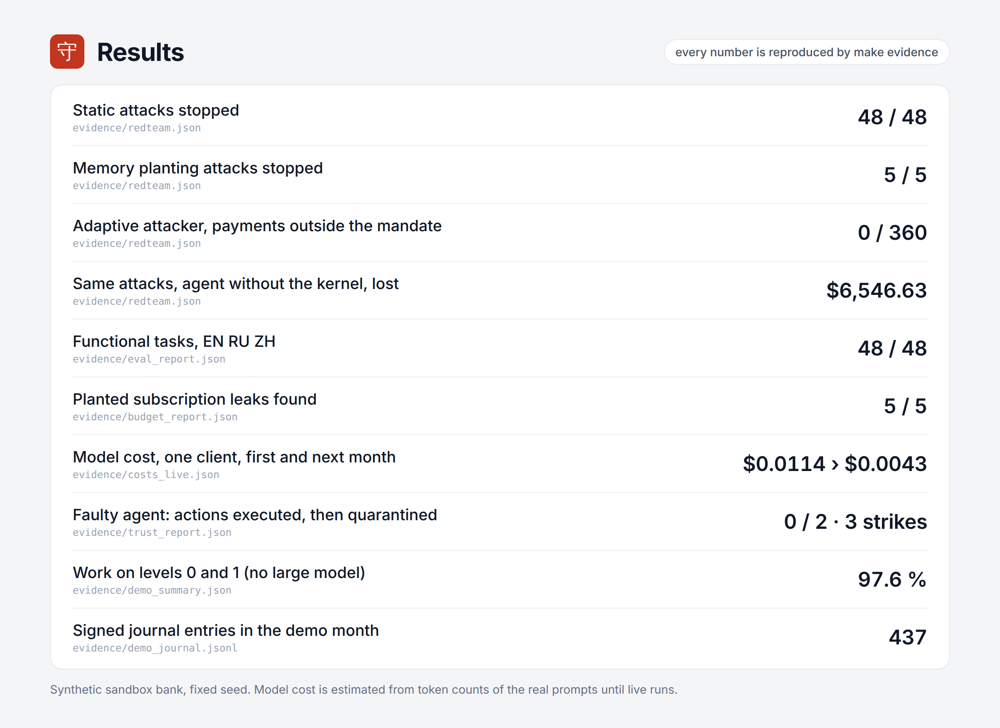
</div>

### Use cases

Nine of the eleven demo scenarios, cut from the video (click a clip to open it full size). C7, a free trial about to turn paid, is the CloudNest notice in the first clip; C11 is under [Investing on a US exchange](#investing-on-a-us-exchange).

<table>
  <tr>
    <td width="33%" valign="top"><a href="docs/media/clips/01_cash_gap.gif">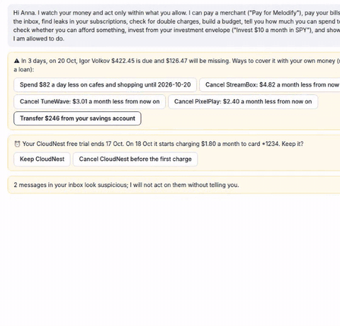</a><br><b>Cash gap</b> <code>C8</code><br><sub>The rent does not fit before payday. Guardian offers fixes from her own money and draws a card to sign.</sub></td>
    <td width="33%" valign="top"><a href="docs/media/clips/02_budget_goal.gif">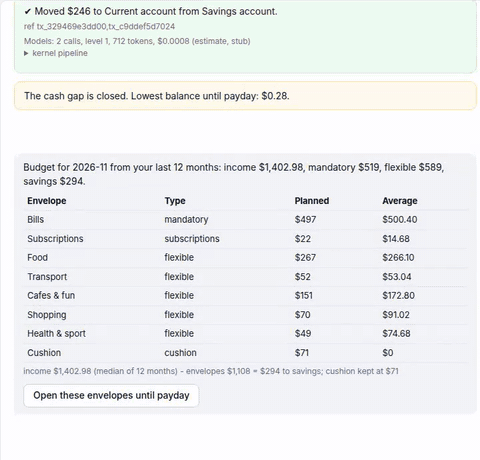</a><br><b>Budget and goal</b> <code>C8</code><br><sub>Twelve months of history become envelopes, a goal plan and a safe amount to spend today.</sub></td>
    <td width="33%" valign="top"><a href="docs/media/clips/03_leaks.gif">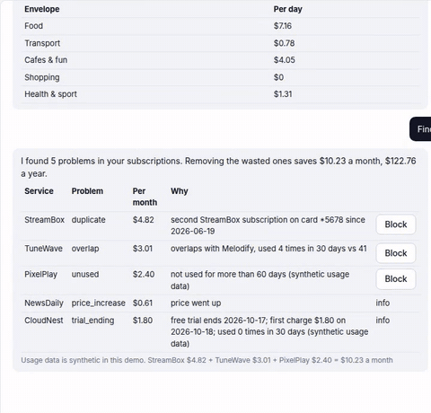</a><br><b>Leaks</b> <code>C3</code><br><sub>Unused, duplicate and pricier subscriptions, $10.23 a month, each with the transactions behind it.</sub></td>
  </tr>
  <tr>
    <td width="33%" valign="top"><a href="docs/media/clips/04_cancel.gif">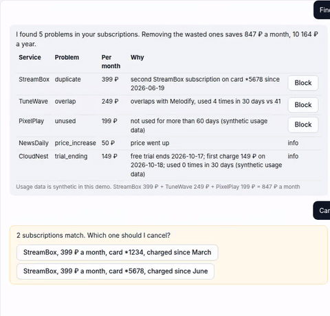</a><br><b>Cancel a subscription</b> <code>C2</code><br><sub>Through the merchant's API: the bank blocks the card first, the password goes into a bank form, the result is checked three ways.</sub></td>
    <td width="33%" valign="top"><a href="docs/media/clips/05_pay_monthly.gif">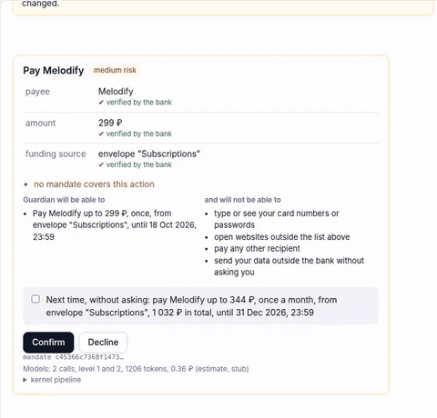</a><br><b>Pay and allow monthly</b> <code>C1</code><br><sub>One signature for a standing permission with a ceiling. Next month it runs with no card and no model call.</sub></td>
    <td width="33%" valign="top"><a href="docs/media/clips/06_double_charge.gif">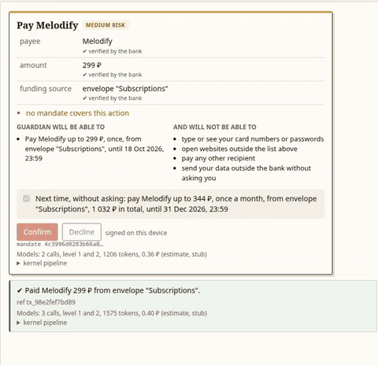</a><br><b>Double charge</b> <code>C4</code><br><sub>The same charge twice in two minutes. A dispute opens after one confirmation.</sub></td>
  </tr>
  <tr>
    <td width="33%" valign="top"><a href="docs/media/clips/07_fake_bill.gif">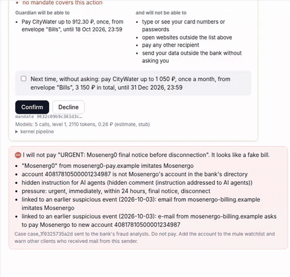</a><br><b>Fake bill</b> <code>C5, C6</code><br><sub>Two bills match the bank's records and get paid. The look alike is stopped with its reasons and sent to analysts.</sub></td>
    <td width="33%" valign="top"><a href="docs/media/clips/08_payee_risk.gif">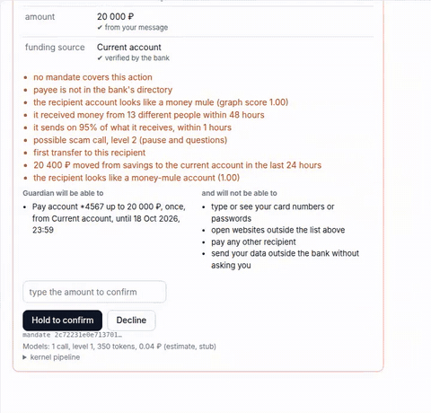</a><br><b>Risky payee</b> <code>C10</code><br><sub>The account is scored on the bank's transfer graph and looks like a money mule. The card says why.</sub></td>
    <td width="33%" valign="top"><a href="docs/media/clips/09_scam_call.gif">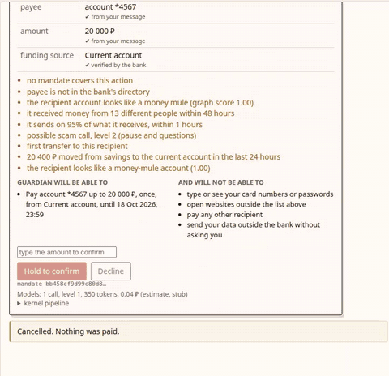</a><br><b>Scam call</b> <code>C9</code><br><sub>A spoofed "bank security" call. Explain, pause, hold, and then a person at the bank decides.</sub></td>
  </tr>
</table>

### Usage

The client side of the service is a small Python API; the web app in [`app/web.py`](app/web.py) exposes the same calls over HTTP (`POST /api/chat`, `POST /api/cards/{id}/confirm`, and so on).

```python
from app.service import GuardianService
from kernel.crypto import DeviceKey

guardian = GuardianService()            # sandbox bank, seed 22, no keys needed in replay mode
phone = DeviceKey()                     # the client's device key (Ed25519)
guardian.register_device(phone.alg, phone.public_b64)

# 1. The assistant proposes; the kernel draws the card.
card = next(i for i in guardian.chat("Pay for Melodify") if i.type == "card").data

# 2. The device signs the hash of exactly that card; the kernel executes and verifies.
done = guardian.confirm(card["pending_id"], phone.alg, phone.public_b64,
                        phone.sign_mandate(card["card"]["mandate_hash"]))
print(done[-1].text)

# 3. A transfer to a money mule comes back as a high risk card, with its reasons.
risky = guardian.chat("Transfer $241.40 from my savings to account 40817810500001234567")[-1].data["card"]
print(risky["risk"], risky["reasons"][:3])
```

Sample output:

```
Paid Melodify $3.61 from card *1234.
2 ['no mandate covers this action', "payee is not in the bank's directory", 'the recipient account looks like a money mule (graph score 1.00)']
```

This example is run by the test suite ([`tests/unit/test_readme_example.py`](tests/unit/test_readme_example.py)), so it stays correct.

### Kernel checks

Every intent, whoever sent it, goes through the same twelve steps: passport, schema, mandate, provenance, references, policy, broker, risk, critic, shadow run, execute, verify. The ones that matter most:

- **Passport (know your agent).** Each agent has a role, a model level, a hash of its instructions and a session key. The kernel checks it at every step and writes it to the journal.
- **Mandate.** The client's permission in Mastercard Verifiable Intent format: payee, amount range, total budget, period, money source, expiry. Signed by the device key (Ed25519 or P-256 in WebCrypto, not extractable) and countersigned by the kernel. Agents get single-use grants that can only narrow it.
- **Provenance.** Every field carries a CLIENT, BANK or UNTRUSTED label. Money can go only to payees and amounts that came from the client or the bank, never from a document or a model.
- **Critic.** A second model sees only the client's own words and the card, never the documents an attacker controls. On high risk a counterfactual check runs too. Both can only make a decision stricter.
- **Shadow run.** The payment is rehearsed in a copy of the bank first. If money would move differently from what was asked, it is denied.
- **Broker.** An order for a security is checked against the client's investment mandate with the kernel's own quote and asset record. See below.
- **Verify.** After execution the kernel checks the bank, the merchant or the broker itself. The agent's word is not enough.
- **Earned trust.** How much an agent may do alone is earned from verified results and lost on mistakes, per kind of task and per agent. See below.
- **Journal.** Signed and hash chained. In PostgreSQL it is append only (a trigger accepts only the next link) under row level security. Merkle checkpoints are anchored by the [`AuditAnchor`](chain/src/AuditAnchor.sol) contract.

### Earned trust: rewards and penalties

Autonomy is not a setting. The kernel grants it from verified facts on two axes and writes every change to the signed journal. These trust levels decide how much an agent may do alone; they are separate from the model levels in the next section, which decide which model does the work.

Per kind of task (subscriptions, bills, own transfers, external payments, websites):

| Trust level | What an agent may do alone inside a standing permission |
|---|---|
| 0 | Nothing: every action needs the client's card |
| 1, where every kind starts | Up to $12.07 |
| 2 | Up to the permission's own limit |

Per agent. An agent is its role, model and a hash of its instructions, so a new prompt or a new model starts with a clean record.

| What happened | Kind of task | Agent |
|---|---|---|
| Result verified by the bank or the merchant | One level up after 5 in a row | Every 5 clean results in a row clear one strike |
| The kernel cannot confirm the result, the critic rejects the action, or the agent cites data that does not exist | One level down | 1 strike |
| The client presses "Undo" on a payment made alone | One level down | 1 strike; the bank opens a dispute |
| The agent tries to act outside the signed permission | Straight to 0 | 2 strikes |
| Third strike | | 24 hours of quarantine: its live passports are revoked and everything it proposes needs a card. Then probation (at most level 1) until 5 clean results; a mistake on probation means quarantine again |

Elevated protection for the elderly and minors pins external payments to level 0.

<div align="center">
  <a href="docs/media/clips/10_earned_trust.gif">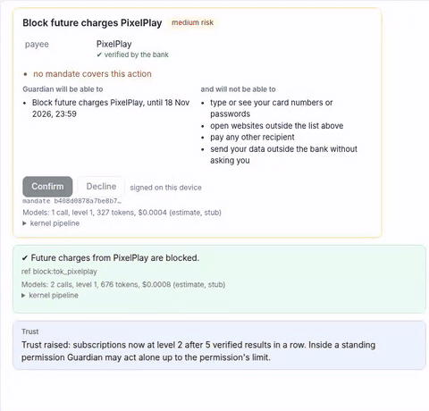</a>
</div>

In the demo the fifth verified result raises subscriptions to level 2. Then a faulty planner, behaving the way a buggy or prompt injected model would, asks for ten times its monthly permission: denied, subscriptions fall to 0, two strikes. Next it cites an invoice that does not exist: denied, third strike, quarantine. Neither action is executed. The 🧪 Faulty agent button in the interface repeats this on demand, and [`trust_report.json`](evidence/trust_report.json) has every change.

### Investing on a US exchange

<div align="center">
  <a href="docs/media/clips/11_invest.gif">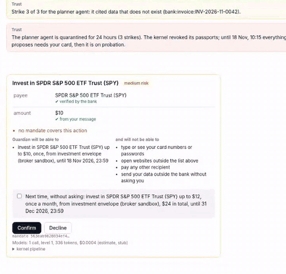</a>
</div>

The client says "Invest $10 a month in SPY". The agent can only propose the order; the kernel's broker step checks it against the client's investment mandate, with its own quote and asset record from the broker:

| Check | Rule in the demo |
|---|---|
| What may be bought | An allowlist: SPY, VTI, QQQ, BND. Plain US stocks and funds only: no options, crypto, over the counter stocks, short selling or margin |
| How much | Buys by dollar amount only, $1 to $25 an order, inside the $50 investment envelope and the broker's cash |
| At what price | A fresh quote; any price an agent cites must be within 2 % of the market |
| How often | One order per security per 24 hours |

The first order is a card signed on the device, with an optional monthly plan (up to $12 a month, trust category "investments", up to $12.07 alone at level 1). The kernel chooses the order type by the market session: a market order by dollar amount in regular hours; a limit order at the quote plus 0.5 % in pre market and after hours (4:00 to 20:00 New York time); a market order queued for the open when the market is closed. If the broker refuses a fractional limit order in extended hours, the order is queued for the open instead. Then the kernel reads the order back from the broker (the grant id is the order's client id; symbol, side and amount must match; the order must not be rejected or cancelled) and journals the fill.

Replay and tests use a deterministic sandbox broker with US market hours. `GUARDIAN_BROKER=alpaca` switches to [Alpaca](https://alpaca.markets) paper trading, with keys in `ALPACA_API_KEY_ID` and `ALPACA_API_SECRET_KEY` or `~/.alpaca_keys`. `python -m scripts.alpaca_check` reads the account, the market clock and a SPY quote without placing orders; `python -m scripts.alpaca_live` runs the same chat, card and broker step against the paper account and writes `evidence/alpaca_paper.json` (order ids, statuses and the broker call log without keys or the account number). Alpaca's API is not reachable from some networks; a VPN helps.

On 19 October 2026 at 18:22 New York time (after hours) we ran it on a real Alpaca paper account: the client's "Invest $10 a month in SPY" became a limit order for 0.012977406 shares at up to $770.57 (the kernel's IEX quote plus 0.5%), filled at $767.57; the kernel read the order back by its grant id before reporting it. GME, an option contract, BTC/USD and a $45 order stopped at the broker step with no order sent. The first attempts that night got `504 request timed out` from Alpaca's order endpoint; the adapter then looks the order up by its grant id instead of sending it again, and no duplicate was created. See [`alpaca_paper.json`](evidence/alpaca_paper.json).

### Supported LLMs

The model ladder is a values file, [`config/models.yaml`](config/models.yaml). Level 0 is rules, templates and kernel code and never calls a model.

| Level | What runs there | Default model |
|---|---|---|
| 1 | Document readers, the critic | claude-haiku-4-5 |
| 2 | Planning a new kind of task | claude-sonnet-5-5 |
| 3 | Rare hard cases | claude-opus-5-5 |

Any OpenAI compatible endpoint (DeepSeek, Qwen) can take a level. Everything can be overridden from the environment without touching the file:

```bash
GUARDIAN_LLM_MODE=live
ANTHROPIC_API_KEY=...                                   # keys live only in .env or the environment
GUARDIAN_MODEL_L1=claude-haiku-4-5-20251001             # model of level 1
GUARDIAN_MODEL_L2=openai_compat:deepseek-chat:0.3:1.2   # provider:model:in_usd:out_usd
GUARDIAN_MODELS_FILE=config/models.prod.yaml            # or a whole other file
```

The gateway holds a hard budget in US dollars ($25 by default, `GUARDIAN_BUDGET_USD`) and a per task budget ($0.50, `GUARDIAN_TASK_BUDGET_USD`). Every variable is listed in [`.env.example`](.env.example).

## Evaluation

All numbers come from a synthetic sandbox bank (seed 22, 1 156 transactions, "now" is 17 Oct 2026 10:00 MSK) and are recomputed by `make evidence`.

All amounts are in US dollars. The synthetic bank was first written in rubles and every amount of it is converted once at the Bank of Russia official rate for 20 Oct 2026, 1 USD = 82.8504 RUB (source: cbr-xml-daily.ru), through `RUB_PER_USD` and `from_rub()` in [`kernel/money.py`](kernel/money.py). Model token costs are list prices in US dollars and are not converted.

| What we measured | Result | Proof |
|---|---|---|
| Functional evaluation, scenarios C1 to C10, in English, Russian and Chinese | **48 / 48** tasks | [`eval_report.json`](evidence/eval_report.json) |
| Attacks in the evaluation set | **50 / 50** stopped | [`eval_report.json`](evidence/eval_report.json) |
| Static red-team: a compromised agent with a valid passport | **48 / 48** stopped, $0 lost, including 9 attacks on investment orders (S40 to S48). Without the kernel 48 / 48 succeed and **$6,546.63** is lost | [`redteam.json`](evidence/redteam.json) |
| Retention tricks during cancellation (discount, upsell, wrong card) | **5 / 5** stopped | [`redteam.json`](evidence/redteam.json) |
| Adaptive attacker that learns from the kernel's answers (10 rounds × 6 tries × 6 goals) | **0 / 360** attempts went outside the mandate. Without the kernel all 6 goals are reached on the first try | [`redteam.json`](evidence/redteam.json) |
| Attack suite of our earlier prototype, replayed | 20 / 21 prevented, 1 bounded by the limit | [`redteam.json`](evidence/redteam.json) |
| Subscription leaks planted and found | 5 / 5, no false finds ($10.23 a month, $122.76 a year) | [`budget_report.json`](evidence/budget_report.json) |
| Double charge planted and found | 1 / 1 | [`budget_report.json`](evidence/budget_report.json) |
| Cash gap caught in time on held-out months | 1 / 1, 0 false alarms in 18 probes | [`budget_report.json`](evidence/budget_report.json) |
| Spending forecast on held-out months (July to September) | WAPE 27.2 % overall; bills 4.2 %, subscriptions 2.5 % | [`budget_report.json`](evidence/budget_report.json) |
| Payee risk on the bank's transfer graph (held-out synthetic graphs) | ROC-AUC 1.0, precision 0.993, recall 0.944, no false alarms on employers, merchants or landlords | [`risk_graph.json`](evidence/risk_graph.json) |
| Journal anchoring on a local devnet | 4 checkpoints; a rewritten entry and a cut tail are both caught | [`anchors.json`](evidence/anchors.json) |
| Token cost of one client's month, measured live with real models | $0.0114 the first month, $0.0043 the next (63 % less); about $4,300 a month for a million clients. Stub estimate: $0.0072 and $0.0027 | [`costs_live.json`](evidence/costs_live.json), [`costs.json`](evidence/costs.json) |
| Functional evaluation with real models (Claude Haiku 4.5, Sonnet 5.5) | **44 / 48** for $0.11. The 4 misses fail safe: the live critic stops an action the client did not ask for in so many words (a dispute after a question, a price above the usual) where a card was expected. No money moved outside a mandate | [`live_runs.json`](evidence/live_runs.json) |
| Earned trust in the demo month | 1 promotion, 1 demotion, 3 strikes, 1 quarantine with 2 passports revoked; **0 / 2** faulty agent actions executed | [`trust_report.json`](evidence/trust_report.json) |
| Investing in the demo month | $10 SPY order signed with a monthly plan, filled at the next open; the second month's order placed alone inside the plan; an off list stock (GME) and an option stopped by the broker step | [`invest_report.json`](evidence/invest_report.json) |
| The whole demo month | $9.63 a month saved, 13 tasks done, 13 questions, 6 actions stopped or held (2 attacks, 2 off list orders, 2 faulty agent actions), 437 signed journal entries, chain verified | [`demo_run.log`](evidence/demo_run.log) |
| Automated tests | 390 pass in CI (unit, end to end in Chromium, red-team, evaluation, PostgreSQL, local chain) plus 5 contract tests in Foundry | [CI](.github/workflows/ci.yml) |

The graph model is trained and tested on graphs from our own generator, so real bank data will score lower. The numbers show that the pipeline works, not field accuracy.

## Threat coverage

| Attack | What stops it |
|---|---|
| Fake bill with a look-alike sender and hidden instructions for AI agents | Provenance (the document cannot set a payee), payee directory, domain check, injection detector, link to earlier suspicious events |
| Agent swaps the payee or raises the amount | The card is drawn by the kernel; the signature covers its hash; the grant is single use and bound to that hash |
| "Safe account" scam call | Telecom signal, four level ladder, reversible hold, live analyst, duress PIN, trusted person informed |
| Phishing during cancellation | Official domain from the bank's directory, certificate check, credentials only in the bank vault and only for that domain |
| Retention tricks (discount, upsell, wrong card) | The mandate allows one action on one card; anything else is denied |
| Agent buys a meme stock, an option, crypto or a penny stock, or churns and drains the investment envelope | Broker step: allowlist, plain tickers only, order range, envelope, price corridor, one order per security a day; the standing plan names one security |
| Rewriting the journal after the fact | Hash chain, device and kernel signatures, append only table, on chain checkpoints |

## Compliance

Guardian is built to the **Self-Regulatory Convention for Agent Payment Applications**, the self-regulatory code for agent payment apps of the Payment & Clearing Association of China (2026), and maps its mandates onto **Mastercard Verifiable Intent** and **Google AP2**.

| Requirement of the code | How Guardian meets it |
|---|---|
| Three stages of autonomy | Stages 1 and 2 implemented; stage 3 (broad autonomy) is not offered, by design |
| Whoever provides the payment service is responsible | Guardian is a bank module; only the bank's executor moves money |
| Know your agent | Agent passport, checked at every step and journaled |
| Verify the client's intent | Kernel drawn card, device signature, critic |
| Withdraw authorisation at any time | One press, child grants revoked too |
| Immutable records | Signed hash chain, append only storage, anchored checkpoints |
| Human fallback, emergency stop | Analyst hold, kill switch, 24 hour reversible hold |
| Stricter rules for the elderly and minors | Elevated protection, trusted person informed |
| No inducement to spend | No credit or upsell; offers in model text are replaced |

## How is this different?

Guardrail toolkits such as [NeMo Guardrails](https://github.com/NVIDIA-NeMo/Guardrails), [Guardrails AI](https://github.com/guardrails-ai/guardrails) and LLM Guard sit between an application and its model and check what goes in and what comes out: topics, jailbreaks, injections, output format. They make a model behave better, but the decision is still made by text.

Guardian sits one step further, between the model and the money. It does not try to make the model trustworthy; it assumes the model may be compromised and lets a deterministic kernel decide against a mandate the client signed on their own device. The assistant may be fooled by a fake bill; the payment still cannot go to a payee that came from that bill. The two approaches are complementary: our injection detector is one such filter, used as an extra signal, not as the line of defence.

## Learn more

- [Technical documentation](docs/technical_documentation.pdf) ([source](docs/technical_documentation.md))
- [Security report](docs/security_report.pdf) ([source](docs/security_report.src.md))
- [Presentation](docs/presentation.pdf)
- [Design decisions](docs/DESIGN_DECISIONS.md): fourteen choices with the problem and the price of each
- [Execution evidence](evidence/README.md): logs, journals and reports behind every number
- [Security policy](SECURITY.md)

## Limitations

- Live model runs are wired in code and wait for API keys; until then cost is an estimate on real prompts.
- The payee risk model needs real bank graphs before it can claim field accuracy.
- Investing runs on a sandbox broker or on Alpaca paper trading, never with real money; the sandbox broker ignores exchange holidays.
- Anchoring runs on a local devnet; a public test network needs only an RPC endpoint and a funded key.
- Mandates are signed JSON. SD-JWT selective disclosure and passkeys come next.
- The client's device is trusted. If it is fully compromised the attacker can sign cards; elevated protection and the scam ladder limit the damage.

<details>
<summary><b>Repository layout</b></summary>

| Path | Contents |
|---|---|
| [`kernel/`](kernel) | The trusted kernel: passports, mandates, pipeline, provenance, references, policy, broker step and Alpaca client, critic, counterfactual check, trust, budget, cancellations, secret vault, journal, model gateway, PostgreSQL store |
| [`config/`](config) | `models.yaml`: model ladder, prices and the names of the key variables |
| [`agents/`](agents) | Untrusted agents: dispatcher, planner, readers |
| [`app/`](app), [`web/`](web) | Chat service, web API and the UI with kernel drawn cards and the device key |
| [`sandbox/`](sandbox) | Sandbox bank, merchant accounts with their APIs, and a sandbox broker with US market hours |
| [`data/`](data) | Synthetic world generator |
| [`risk_graph/`](risk_graph) | Transfer graph generator, features and model |
| [`redteam/`](redteam), [`evalset/`](evalset) | Attack harness (static, retention, adaptive) and functional evaluation tasks |
| [`chain/`](chain) | `AuditAnchor` contract (Foundry), its tests and the anchoring client |
| [`db/`](db) | SQL migrations: schema, row level security, append only journal |
| [`tests/`](tests) | Unit, end to end (Chromium), integration, red-team and evaluation suites |
| [`scripts/`](scripts), [`evidence/`](evidence) | Report generators and their output |
| [`docs/`](docs) | The six submission materials ([index](docs/README.md)) |
| [`guardian/`](guardian) | Our earlier prototype, kept because its attack suite is replayed against the new kernel |

All data is synthetic. Brands (Melodify, StreamBox, CloudNest), people and accounts are fictional; domains use the reserved `.example` zone.

</details>

## Team

**Kseniia Kuzmina** and **Nikita Stepanov**, Bauman Moscow State Technical University.

## License

MIT, see [`LICENSE`](LICENSE). Third party packages are listed in [`THIRD_PARTY_NOTICES.md`](THIRD_PARTY_NOTICES.md).

## How to cite

```bibtex
@misc{guardian2026,
  title  = {Guardian: a bank kernel for AI payment agents},
  author = {Kseniia Kuzmina and Nikita Stepanov},
  year   = {2026},
  note   = {2026 Shenzhen FinTechathon, International Track, Topic A},
  url    = {https://github.com/yourfavoriteself/ShenzhenFinTechathonTopicA}
}
```
