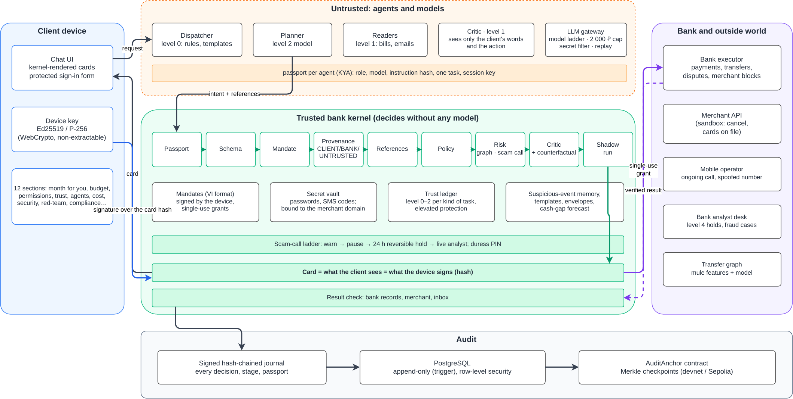

# 1. Summary

Guardian is an AI assistant inside a bank's mobile app. It finishes money tasks for the client: it pays, cancels subscriptions, disputes charges, pays bills, builds and runs the budget, saves toward goals, and invests small sums on a US exchange. Next to it sits a bank kernel that lets the assistant do exactly what the client signed and nothing more.

The design rests on one rule: **models propose, code decides.** Agents (dispatcher, planner, readers) are untrusted. They send *intents* with references to where every value came from. A deterministic kernel then checks each intent:

- the agent's passport;
- the mandate the client signed;
- the provenance of every field;
- the bank's records;
- risk.

The kernel then either asks the client with a card it renders itself, or executes through a single-use grant. It checks the result with the bank or the merchant and writes everything to a signed, hash-chained journal.

| Promise | Mechanism |
|---|---|
| The agent finishes the job | Eleven scenarios end to end on a sandbox bank and a sandbox broker; every result is verified from independent sources |
| The agent does exactly what you confirmed | Mandates in Mastercard Verifiable Intent format, signed by the client's device key; single-use grants; provenance labels |
| You never give the agent passwords or card numbers | Secret vault bound to the merchant domain; protected sign-in form; the LLM gateway refuses prompts with secrets |
| Repeat tasks are almost free | Model ladder; templates replay solved tasks with no model; the next month costs 63 % less than the first |

Topic A asks for smart budgeting, bill analysis and spending analytics:

- **Budgeting** is scenario C8: auto-budget from history, envelopes, safe-to-spend, cash-gap forecast, salary split, goals.
- **Bill analysis** is C5 and C6: verification of every bill and detection of fake bills.
- **Spending analytics** is C3 and C4 (leaks, double charges) plus the month review.

The theme, *AI as a Financial Participant*, is the core of the design: the assistant acts, and the kernel makes acting safe.

The system is about 11 000 lines of Python, JavaScript and Solidity, with 3 500 lines of tests (392 tests, all green in CI with PostgreSQL and a local chain, plus 5 contract tests). It runs with `docker compose up` and needs no API keys in the default replay mode.

# 2. Scenarios

All data is synthetic. A generator builds one client with twelve months of history (1 156 transactions; seed 22; "now" is 17 Oct 2026 10:00 MSK). Brands, people and domains (`.example`) are fictional.

All amounts are in US dollars and are stored as integer cents. The synthetic bank was first written in rubles; every amount of it is converted once at the Bank of Russia official rate for 20 Oct 2026, 1 USD = 82.8504 RUB (source: cbr-xml-daily.ru). The rate is one named constant, `RUB_PER_USD` in `kernel/money.py`, and the generator, the kernel limits and the tests convert through `from_rub()`, so every converted amount is visible in the code. Model token costs are list prices in US dollars and are not converted.

| # | Client says | What happens | Verified by |
|--|--------|------------------------|----------|
| C1 | "Pay for Melodify" | The planner builds an intent from kernel facts. The card shows payee, amount and source, all *verified by the bank*. The client signs once and can allow it monthly. Next month the payment runs from a template with no model and only a notification | Bank statement |
| C2 | "Cancel the $4.82 subscription" | Two subscriptions match, so the kernel asks which. After the signature the bank blocks future charges from that merchant on that card (insurance). The cancellation desk then signs in on the merchant's official domain: credentials come from the bank vault, the SMS code is typed by the client. It cancels through the merchant API | Three sources: merchant removed the card on file; confirmation e-mail from the official domain; no charge when the bank ran time forward |
| C3 | "Find leaks in my subscriptions" | Unused, duplicate and price-raised subscriptions, each with the transactions it is based on: $10.23 a month, $122.76 a year | Kernel analytics, 5/5 planted leaks found |
| C4 | "Was I charged twice?" | The double charge is found with its two transaction ids; a dispute card follows | Dispute status in the bank, refund 3 days later |
| C5 | "Pay my bills" | Readers extract fields from each bill. The kernel checks every field: the value occurs in the document, the account is in the payee directory, the sender domain is official, the amount fits history. Payment comes from the "Bills" envelope | Bank statement; bill marked paid |
| C6 | (a fake bill in the inbox) | Look-alike sender, an account not in the directory, pressure words, hidden text for AI agents, and a link to an earlier suspicious e-mail: a case file for fraud analysts instead of a payment | Case opened, nothing paid |
| C7 | (trial ends tomorrow) | Guardian asks before the first charge; cancelling runs C2 under a mandate that expires at the first charge | No charge after the trial |
| C8 | "Make me a budget", "Save $724.20 by July, don't touch the gym", "Can I afford…" | Budget from 12 months, envelopes, safe-to-spend today, cash-gap warning with fixes from the client's own money (never credit), salary split on payday, goal plan, money freed by cancellations sent to the goal, month review, forecast accuracy | Back-test on held-out months |
| C9 | "Transfer $4,224.48 to a safe account…" during a call | The telecom reports an ongoing call from a spoofed number. The kernel applies the scam-call ladder: explain → pause with three questions and PIN → 24-hour reversible hold with the trusted person told → live analyst. A duress PIN shows an ordinary receipt while nothing leaves | Hold record; the analyst's decision in the journal |
| C10 | "Transfer $241.40 to account …" | The payee account is scored on the bank's own transfer graph. A mule-like collector raises the risk and the ladder level; an ordinary account is not flagged | Model evaluated on held-out graphs |
| C11 | "Invest $10 a month in SPY" | The agent proposes an order; the kernel's broker step checks it with its own quote and asset record (allowlist, plain tickers, order range, investment envelope, price corridor, order frequency). The client signs a card and can allow a monthly plan. The kernel picks the order type by market session and places the order; off-list requests ("Buy $10 of GME", an option) are denied | The order read back from the broker; the fill in the journal |

`scripts/demo_run.py` runs the whole month (all eleven scenarios, then one month later). It writes the readable log `evidence/demo_run.log` and the signed journal `evidence/demo_journal.jsonl`.

# 3. Architecture



There are four trust zones:

1. **Client device.**
   - Chat UI with cards rendered by the kernel.
   - A device key in WebCrypto: Ed25519, or ECDSA P-256 where Ed25519 is unavailable. The key is non-extractable.
   - The protected sign-in form for merchant credentials.
2. **Untrusted agents and models.**
   - Agents:
     - dispatcher: level 0 rules and templates, a level 1 model only if no rule fits;
     - planner: level 2;
     - readers: level 1, one document in, one structure out, no tools.
   - The critic (level 1) runs inside the kernel's pipeline but is a model, so it can only say "no" or "ask".
   - Every model call goes through the LLM gateway.
   - Every agent session holds a kernel-signed **passport**.
3. **Trusted kernel.** The only component that can move money. Its "allow" is always deterministic code.
4. **Bank and outside world.**
   - The bank executor (payments, transfers, disputes, merchant blocks).
   - The broker (a sandbox broker, or Alpaca paper trading).
   - Merchant APIs (sandbox).
   - The mobile operator's call signal.
   - The analyst desk.
   - The transfer graph.

Requests flow as follows:

1. The client's request reaches the dispatcher.
2. An agent proposes an intent with references.
3. The kernel resolves each reference itself and runs the pipeline.
4. The kernel renders a card.
5. The client's device signs the card's hash.
6. The kernel turns the signature into a mandate and issues a single-use grant.
7. The executor acts.
8. The kernel reads the bank back to confirm the result.

Every step is journaled with the autonomy stage and the passport of the agent involved.

# 4. The kernel

## 4.1 Decision pipeline

Every step can only tighten the verdict (allow → ask → deny). LLM-based steps plug in like the others but can only say "no" or "ask the client".

| Step | Checks | Typical reasons |
|----|----------------|----------|
| Passport | Session signature, fresh nonce, role may call this endpoint, passport not expired, task matches | forged passport, wrong session key, replay, reader calling `propose_intent` |
| Schema | Action and fields are well formed; amounts are integers in cents | amount must be a positive integer in cents |
| Mandate | A signed mandate covers the action: payee in `allowed_payees`, amount in `amount_range`, budget and recurrence left, funding source, origin, not expired, not revoked | no mandate covers this action; already used this period |
| Provenance | Each field's label (CLIENT, BANK, UNTRUSTED) is assigned by the kernel from the reference, never by the model. Payee, amount and source must come from the client or the bank | payee comes from an unverified source |
| References | Every cited reference exists and resolves to the same value | reference to data that does not exist |
| Policy | Envelope balance, trust level, elevated protection, domain sets, no credit products, kill switch | envelope overspend; trust level 1 allows $12.07 alone |
| Broker | For `invest` only: the order against the client's investment mandate, with the kernel's own quote and asset record from the broker (section 4.7) | GME is not on the client's list of securities; the cited price is 13.4% away from the market price |
| Risk | Payee directory, look-alike names, suspicious-event memory, usual amount, transfer-graph score, scam-call ladder | payee not in the directory; money mule (graph score 1.00) |
| Critic | A small model that sees only the client's words, the mandate and the action as structured fields with labels; cached; three refusals in a row return control to the client | $36.09 is far above the usual $3.61 |
| Counterfactual | On high risk only: the planner step is replayed with the client's request masked. If the same action reappears, it is driven by data rather than the client (after MELON, ICML 2025) | the agent proposes the same payment even without your request |
| Shadow | The payment is rehearsed on a copy of the bank: exactly one debit to the payee for the amount (or a move between the client's own accounts) and nothing else. A movement the bank would refuse goes back to the client | a dry run in a copy of the bank failed: insufficient funds; the dry run moved money differently from what was asked |

After execution, `result.verified` reads the bank statement (or merchant account, inbox, or the broker's order record) to confirm the effect. Only a verified result raises trust.

## 4.2 Mandates, cards and grants

A mandate is the exact right an agent gets after the client says "yes". Field names follow Mastercard Verifiable Intent constraints. Our extensions are `allowed_origins`, `funding_source` and `secret_refs`.

```json
{"id": "mdt_6f0263675996", "version": "vi-0.1", "client_id": "cl_1", "actions": ["pay"],
 "payment": {"allowed_payees": ["tok_melodify"],
             "amount_range": {"min": 0, "max": 500, "currency": "USD"},
             "budget": {"total": 1500, "currency": "USD"},
             "agent_recurrence": {"frequency": "monthly", "max_occurrences": null},
             "reference": "7e47bb9b6f6d78c6…"},
 "allowed_origins": [], "funding_source": "card_1234", "secret_refs": [],
 "nbf": "2026-10-17T10:00:00+03:00", "exp": "2026-12-31T23:59:00+03:00",
 "standing": true, "single_use": false, "stage": 2, "parent_id": null, "holder": "client"}
```

The card for this mandate reads: *Pay Melodify up to $5, once a month, from card \*1234, $15 in total, until 31 Dec 2026, 23:59* (amounts are cents in the mandate; `reference` is the hash of the card the client saw).

- **Card.** Rendered by the kernel from the mandate, never by a model. It lists what the agent will be able to do. It shows the provenance badge of every field and highlights what changed since last time. It carries the mandate hash.
- **Signature.** The device signs the hash. The kernel verifies it against the registered device key and countersigns. The card may require typing the amount (scam-call level 1+), answering questions and the PIN (level 2+).
- **Grant.** A single-use right for exactly one action, derived from the mandate. Rights only narrow: a child must fit inside its parent. A spent grant cannot be reused; a revoked mandate revokes its children.
- **Stages.** Operations are stage 1 (assisted: every payment through a card) or stage 2 (preset conditions: standing mandates with limits). Stage 3 (broad autonomy) is deliberately not supported, as the 2026 agent payment code allows.

## 4.3 Passports (Know Your Agent)

Each agent session gets a passport signed by the kernel. It contains:

- id, role, model and model level;
- the SHA-256 of the system instructions and the instruction-set version;
- the task id;
- issue and expiry times (one hour);
- an Ed25519 session key.

Requests are signed with the session key and carry a fresh nonce. Endpoints are allowed by role:

| Role | Endpoints |
|---|---|
| dispatcher | `route`, `lookup_templates`, `propose_intent` |
| planner | `propose_intent`, `query_data`, `request_grant` |
| reader | `submit_extraction` |
| critic | none (called by the kernel) |
| executor | `execute` |

## 4.4 Earned trust: rewards and penalties

Autonomy is granted by the kernel from verified facts on two axes. Every change is a `trust.changed` entry in the signed journal, with the agent, the passport and the reason.

**Per kind of task** (subscriptions, bills, own transfers, external payments, websites):

- **Level 0:** a card for everything.
- **Level 1:** within a standing mandate the agent may act alone up to $12.07. Every kind starts here.
- **Level 2:** alone up to the mandate's limit.
- **Promotion** after 5 verified results in a row.
- **Demotion** by one level on a mistake: a result the bank could not confirm, an action the critic rejected, a reference to data that does not exist, or a payment the client reversed. A scope violation (acting outside the signed mandate) drops the kind straight to 0.
- **Elevated protection** (elderly, minors) pins external payments to level 0 and starts the scam-call ladder at the pause.

**Per agent.** An agent is identified by its role, model and the hash of its instructions, so a new prompt or a new model starts with a clean record. The effective level of an action is the lower of the two axes.

| Agent status | Cap on its level | How it gets there | How it leaves |
|---|---|---|---|
| Active | 2 | Start | 3 strikes |
| Quarantined | 0 | 3 strikes (a mistake is 1, a scope violation is 2), or any mistake on probation | After 24 hours, to probation |
| Probation | 1 | End of quarantine | 5 verified results in a row |

Quarantine revokes every live passport of the agent (`agent.passports_revoked` in the journal), so a task that is already running stops at the next call. Every 5 clean results in a row also clear one strike.

**Client reversal.** A receipt for an action taken alone inside a standing permission carries an "Undo" button. It opens a bank dispute and calls `Kernel.reverse`, which journals `action.reversed` and records a penalty for the agent and the kind of task.

**Fault injection.** The demo has a "Faulty agent" button. It makes the real planner (same role, model and instructions) first ask for ten times its monthly permission and then cite an invoice that does not exist. Both are denied, the planner collects three strikes and is quarantined. The numbers are in `evidence/trust_report.json`: 1 promotion, 1 demotion, 3 strikes, 1 quarantine, 2 passports revoked, 0 of 2 faulty actions executed.

## 4.5 Secrets and cancellations (C2)

The vault stores merchant credentials encrypted with AES-GCM; the merchant's domain is part of the associated data. Agents see only references such as `{{secret:streambox.password}}`. Every plaintext is registered with the gateway's guard, so a leak into any prompt fails the call. SMS codes are one-time and destroyed after use.

The cancellation desk runs in five steps:

1. Block future charges from the merchant on the card (insurance).
2. Check the merchant's domain against the directory and look-alike detection.
3. Sign in through the protected form (credentials typed by the client go straight to the vault), or with saved credentials.
4. Cancel through the merchant API.
5. Verify from three sources.

The merchant's full card number is reduced to the last four digits at once.

## 4.6 Documents, suspicious memory and reference checks

- **Documents.** Readers return fields by schema. The kernel accepts a field only if:
  - it literally occurs in the document;
  - the account matches the directory;
  - the sender domain is official;
  - the amount fits the client's history.

  Accepted fields get the `document_verified` label and a reference agents may cite.
- **Injection screening.** Instructions aimed at AI agents and pressure tactics are detected in untrusted text. They never unlock anything; they only add reasons to stop.
- **Suspicious-event memory.** Look-alike senders, changed bank details and the like are remembered per client by the kernel only; agents cannot read or change this memory. This catches two-step attacks ("we changed our details" this week, a bill to the new details next week).
- **Reference check.** Models only phrase replies from kernel facts. Every number in a reply must be one the kernel supplied; otherwise the kernel's template is shown. Replies that offer credit, instalments or "pay later" are replaced unless the facts mention it.

## 4.7 Investing on a US exchange (C11)

Investing is an ordinary intent: action `invest`, payee = ticker, amount in cents. It goes through the same pipeline, plus the broker step, its own trust category ("investments") and its own executor and verifier (`kernel/investing.py`, `kernel/broker.py`).

**Broker step.** The kernel fetches the asset record, a quote, the account and the positions from the broker itself and checks the order against the client's investment mandate:

| Check | Rule in the demo |
|---|---|
| Security | On the allowlist (SPY, VTI, QQQ, BND); a plain ticker (an option symbol or a crypto pair is refused by its shape); class `us_equity`; tradable; not over the counter; fractionable for dollar buys |
| Shape | Buys by dollar amount only, $1 to $25 an order; sells by shares and never more than held (no short selling) |
| Money | Inside the $50 investment envelope and the broker's cash and buying power (a cash account, no margin); the account active |
| Price | While the market is open the quote is at most 15 minutes old; any price an agent cites in its memo must be within 2 % of the kernel's quote |
| Frequency | One order per security per 24 hours |

The first order is a card on the device. The standing offer is a monthly plan for that one security, capped at the amount plus 15 % rounded up to a dollar ($12 for $10). Inside it the agent acts alone up to the trust limit of the "investments" category (level 1: $12.07).

**Execution by market session** (New York time on weekdays):

| Session | Order |
|---|---|
| Regular, 9:30 to 16:00 | Market order by dollar amount, day |
| Pre market and after hours, 4:00 to 9:30 and 16:00 to 20:00 | Limit order at the quote plus 0.5 %, `extended_hours`; the dollar amount becomes shares rounded down to 9 decimals, so the order never exceeds it |
| Closed | Market order by dollar amount, queued by the broker for the next open |

If the broker refuses a fractional limit order in extended hours, the kernel places the queued market order instead and notes why. The grant id is sent as the order's `client_order_id`.

**Verification.** The kernel reads the order back from the broker: same `client_order_id`, symbol, side and amount (or shares times limit within the amount), and a status other than rejected, cancelled or expired. Fills happen on the exchange's time, so the service re-reads open orders as time passes and journals each fill (`order.filled`).

**Brokers.** `sandbox/broker/sim.py` is a deterministic broker with US market hours (holidays ignored) and seeded prices; replay mode and the tests use it. `GUARDIAN_BROKER=alpaca` switches to Alpaca paper trading over its REST API (`kernel/brokers_alpaca.py`, quotes from the IEX feed). Keys come from `ALPACA_API_KEY_ID` and `ALPACA_API_SECRET_KEY` or `~/.alpaca_keys`; they travel only in request headers, and the call log redacts the account number. `python -m scripts.alpaca_check` reads the account, clock and a SPY quote without placing orders. `python -m scripts.alpaca_live` runs the C11 chat, card and broker step against the paper account and writes `evidence/alpaca_paper.json` with order ids, statuses and the call log. Alpaca's API is not reachable from some networks; a VPN helps.

On 19 October 2026 at 18:22 New York time (after hours) we ran it on a real Alpaca paper account: the client's "Invest $10 a month in SPY" became a limit order for 0.012977406 shares at up to $770.57 (the kernel's IEX quote plus 0.5%), filled at $767.57; the kernel read the order back by its grant id before reporting it. GME, an option contract, BTC/USD and a $45 order stopped at the broker step with no order sent. The first attempts that night got `504 request timed out` from Alpaca's order endpoint; the adapter then looks the order up by its grant id instead of sending it again, and no duplicate was created.

**In the demo month** (`evidence/invest_report.json`): the client signs a $10 SPY order with a monthly plan on a Saturday, so it waits for Monday's open and fills there; a month later the next $10 order is placed alone inside the plan; "Buy $10 of GME" and an option are stopped by the broker step.

# 5. Budget engine (C8)

All amounts are computed by deterministic code in `kernel/budget.py`; a model may only phrase the explanation.

- **Auto-budget.** Twelve months of history give income, mandatory payments, flexible categories and a savings target. Envelopes (Bills, Subscriptions, Food, Transport, Fun, Shopping, Health) become sub-balances of the current account.
- **Envelopes as a boundary.** An envelope is the `funding_source` of a mandate. The kernel never lets an agent pay beyond what the envelope holds, and an agent cannot move money between envelopes. Overspending gives the client a card with options.
- **Safe to spend today:**

  $$\text{safe per day} = \frac{\text{balance} - \text{payments due before payday} - \text{goal transfers} - \text{cushion}}{\text{days to payday}}$$

- **Cash gap.** Salaries, recurring charges and bills are replayed day by day until the next income. A gap is shown with fixes from the client's own money only (savings, moving a payment, cutting an envelope), never a loan. Back-test: 1 of 1 gap predicted at least 3 days ahead, 0 false alarms in 18 probes.
- **Salary split** on payday: bills first, then subscriptions, goal and envelopes, with a note when an upcoming payment falls before the next salary.
- **"Can I afford it?"** The purchase is replayed against the forecast; the answer names the payment it would endanger.
- **Goals.** Example: $724.20 by 1 July 2027 means $81 from each of 9 salaries, with every month checked to keep bills covered and the untouchable category ("don't touch the gym") excluded from cuts. Money freed by cancellations can be added to the goal.
- **Month review and forecast quality.** Plan versus actual, spending spikes, late-night spending, price changes. Envelope forecasts for July to September 2026 were planned from the nine months before: WAPE is 27.2 % overall (bills 4.2 %, subscriptions 2.5 %, discretionary categories higher).

# 6. Payee risk on the transfer graph (C10)

- **Generator.** `risk_graph/generator.py` builds a synthetic intra-bank transfer graph (about 600 accounts per graph).
  - Normal life: salaries (legitimate fan-out), rent and shops (legitimate fan-in), friends and family, loans paid back.
  - Four planted mule schemes: ring, structuring below $181.05, fan-in/fan-out collector, chain through fresh accounts.
- **Features.** Fourteen per-account features computed only from transfers known at the scoring time:
  - account age;
  - in and out counts, unique counterparties, log volumes;
  - pass-through share, holding time;
  - transfers just below the threshold;
  - cycle membership, 48-hour bursts, regularity of outgoing amounts;
  - share of young peers.
- **Model.** Gradient boosting (scikit-learn), trained on graphs with seeds 101 to 103 and tested on graphs with seeds 201 to 205. Test accounts, victims and schemes were never seen in training.
- **Results on held-out graphs.** ROC-AUC 1.0, precision 0.993, recall 0.944, false-positive rate 0.0004, zero false positives on employers, merchants and landlords.
- **Recall by scheme.** Ring 0.972, structuring 0.907, fan-in/out 1.0, chain 0.893.
- **Caveat.** These are synthetic graphs from our own generator: the numbers show the pipeline works, not field accuracy.
- **Use.** A score of 0.7 or more adds a risk reason, asks the client and raises the scam-call ladder level. An unknown account gets no opinion.

# 7. Model ladder and cost

| Level | What | Used by |
|---|---|---|
| 0 | Kernel code, rules, templates | Dispatcher rules, templates, all decisions |
| 1 | Small model (Claude Haiku 4.5) | Readers, critic, counterfactual, reply wording |
| 2 | Medium model (Claude Sonnet 5.5) | Planner for new tasks |
| 3 | Large model, escalation only | Failed schema or low confidence at level 2 |

The LLM gateway is the only path to a model. It:

- holds the keys;
- starts at the cheapest level and escalates on facts (schema failure, low confidence, refusal);
- enforces a hard cap of $25 for the whole project (about 2 071 ₽ at the rate in section 2) plus a per-task budget of $0.50;
- refuses prompts with card numbers or vault secrets;
- records responses for replay.

Modes: `replay` (default; falls back to deterministic stubs when no recording exists), `stub`, `record`, `live`.

Cost of one client's month, from `evidence/costs_live.json`, is measured on a live run with real models (Claude Haiku 4.5 on level 1, Claude Sonnet 5.5 on level 2, Claude Opus 5.5 on level 3) at list prices. The stub estimate in `evidence/costs.json` ($0.0072, then $0.0027) stays as the reproducible baseline.

| | Model calls | Big-model calls | Tokens | Cost |
|---|---|---|---|---|
| First month (seven tasks) | 13 | 1 | 5 362 | $0.0114 |
| Next month (same tasks) | 7 | 0 | 2 585 | $0.0043 (63 % less) |

The repeated Melodify payment and the repeated double-charge check use no model at all. At the next-month rate a million clients cost about $4,300 a month in model tokens. In the full demo run 97.6 % of the work happens at levels 0 and 1.

**Live run with real models** (`scripts/live_report.py`, `evidence/live_runs.json`). The functional evaluation with real models passes 44 of 48 tasks for $0.11 (120 calls, 111 on level 1, 9 on level 2). All four misses go the safe way: the live critic stops an action the client did not ask for in so many words, where the evaluation expected a card. "Was I charged twice?" is a question, so the critic refuses to open a dispute on it; a Melodify price of $6.02 against the usual $3.61 is stopped instead of shown for signing. No money moved outside a mandate. We also tried real models as the adaptive attacker: Claude Sonnet 5.5 and Opus 5.5 declined the attacker role for five of the six goals, and the four attempts they wrote for the sixth were all denied. An open model accepted the role: DeepSeek V4 Pro, through the same gateway, made 156 attempts over the 6 goals in 5 rounds and reached none of them, with 0 actions outside a mandate, for $1.75. 17 attempts were held as cards for the client's signature, the rest were stopped by the kernel, and the vault released the saved password only to the merchant's own domain. A second run with wider fields (its own reference strings, permission ids named directly) and the whole history made 187 more attempts in up to 8 rounds, again with none reaching its goal ($2.50).

# 8. Data, persistence and anchoring

- **PostgreSQL** (enabled by `DATABASE_URL`; `docker compose` sets it).
  - Tables: `journal`, `mandates`, `vault_entries` (ciphertext only), `holds`, `cases`.
  - The application writes as the `guardian_app` role with the client set for the transaction, so row-level security applies to the application itself.
  - The journal is append-only: a trigger accepts only the next link of the hash chain, and every kernel run writes its own chain.
  - Migrations are in `db/migrations`; the tests run with `make test-pg`.
- **Journal.** Each entry has a sequence number, time, actor, event, data, autonomy stage, passport id, the previous hash, its own hash and an Ed25519 signature. `verify()` checks the chain and every signature.
- **Anchoring.** Merkle roots over entry hashes are written to the `AuditAnchor` contract (Solidity 0.8.30, Foundry, 5 contract tests): owner-only `anchor(chain, seq, root, head)`, with sequence numbers that only grow per chain.
  - The demo anchors four checkpoints on a local anvil devnet and reads them back.
  - The original journal matches. A rewritten-and-rehashed entry fails (Merkle root differs). A cut tail fails (the anchor covers more entries).
  - Only hashes, a sequence number and a run identifier go on chain.
  - Sepolia is supported by `make anchor` with an RPC and a funded test key.

# 9. Interfaces

**Web app** (`localhost:8000`):

- the chat with kernel cards, device signing, the protected sign-in form and receipts;
- the investment envelope and portfolio in the Budget section, and a portfolio answer in the chat;
- twelve side sections: Month for you, Payments, Budget, Permissions (with one-tap revoke), Trust (with elevated protection), Agents at work, Cost, Security, Red-team, Compliance, Inbox, Journal;
- demo buttons that move the simulated clock and simulate a scam call.

**HTTP APIs:**

- **App** (`/api/…`): state, sections, chat, device registration, card confirm and decline, options, budget, mandates, cancellations, vault, time, demo call, protection, holds, journal, cases, server-sent events.
- **Kernel** (`/agent/…` with signed requests, client card endpoints, `/journal`, `/journal/verify`, `/journal/checkpoint`, `/operator/halt|resume` behind an operator token).
- **Sandbox bank** (HTTP rails with an executor token).
- **Broker**: the sandbox broker in process, or Alpaca's paper trading REST API.

# 10. Testing and evaluation

| Suite | Content | Result |
|---|---|---|
| Unit | Kernel modules, budget, analytics, crypto, journal, trust, graph features | pass |
| End-to-end | All scenarios through the service; the UI in Chromium (Playwright) | pass |
| Evaluation set | 48 functional tasks (C1 to C10, cross-cutting; English, Russian, Chinese) | 48 / 48 |
| Attacks in the evaluation set | 44 static and retention attacks + 6 adaptive goals | 50 / 50 stopped |
| Red-team | 48 static (9 of them on investment orders), 5 retention, adaptive search (360 attempts) | 48 / 48 and 5 / 5 stopped, 0 / 360; see the security report |
| Integration | PostgreSQL (RLS, append-only chain), anchoring on anvil | pass with `make test-pg`, Foundry |
| Contract | `forge test` | 5 / 5 |

Reproduce:

- `make test` runs the test suites;
- `make evidence` produces all reports;
- `make anchor` runs the chain part.

The Docker image runs the whole suite at build time. A clean clone with the pinned requirements passes the suite and serves the app in replay mode without keys.

# 11. Deployment

```bash
docker compose up --build         # app + PostgreSQL 18, http://localhost:8000
```

- Python 3.14.
- Dependencies are pinned (`requirements.txt`).
- Configuration lives in `.env` (see `.env.example`): `GUARDIAN_LLM_MODE`, `ANTHROPIC_API_KEY` and `ANTHROPIC_BASE_URL` (live only), `GUARDIAN_BUDGET_USD`, `GUARDIAN_TASK_BUDGET_USD`, `GUARDIAN_BROKER`, `ALPACA_API_KEY_ID` and `ALPACA_API_SECRET_KEY` (Alpaca only), `DATABASE_URL`, `POSTGRES_PASSWORD`, `GUARDIAN_OPERATOR_TOKEN`.
- The model ladder is a values file, `config/models.yaml`: provider, model, prices and the effort flag for each level, plus the names of the variables that hold each provider's key and endpoint. Environment variables override it per level (`GUARDIAN_MODEL_L1`, `GUARDIAN_PROVIDER_L1`, `GUARDIAN_PRICE_L1_IN`, `GUARDIAN_PRICE_L1_OUT`, `GUARDIAN_EFFORT_L1`) or replace the whole file (`GUARDIAN_MODELS_FILE`). No model name and no key is written in the code.
- In a bank, the kernel, vault and executors run inside the bank's perimeter. Models are reached through the gateway only; a self-hosted model can replace a level without changing the kernel.

# 12. Ethics and responsible design

- **The assistant sells nothing.** It offers no credit, instalments or upgrades. Cash gaps are closed only with the client's own money. Credit offers in model text are replaced.
- **No pressure.** Cards are calm and factual. The assistant never uses urgency, and retention tricks from merchants (discounts, "pause instead", annual upsell) are refused by the kernel.
- **Fewer, better questions.** The client is asked once per new kind of action. Trust is earned from verified results, and standing permissions stay revocable with one tap.
- **Vulnerable clients.** Elevated protection, a trusted person, a duress PIN and a live analyst. The kernel never blocks accounts or calls the police on its own.
- **Privacy.** Models see structured facts, not raw statements, account numbers or secrets. Only hashes go on chain.
- **Explainability.** Every amount carries a calculation and the transactions behind it, and every decision carries its reasons in the journal.

# 13. Limitations

- The bank, merchants, telecom and transfer graph are sandboxes with synthetic data. Real data will be noisier, especially for the graph model.
- Cancellation uses merchant APIs. Merchants without an API would need a separate, strictly sandboxed integration, which we did not build.
- Live runs are one month of one client; the live critic is stricter than the stub and stops four tasks the evaluation expected as cards. The vendor models declined to act as the adaptive attacker for most goals; the open model DeepSeek V4 Pro played it in two runs (343 attempts). A longer run and a second open model (Qwen) are next.
- Mandates are signed JSON. SD-JWT selective disclosure from Verifiable Intent is not implemented.
- Investing runs on a sandbox broker or Alpaca paper trading, never with real money. The sandbox broker ignores exchange holidays; the allowlist and limits are demo values, not advice.
- Anchoring was demonstrated on a local devnet. Sepolia needs a funded test key.
- One client per demo world; scaling numbers are projections.

# 14. What's next

- Pilot with a bank's real payee directory and fraud labels.
- SD-JWT mandates.
- Merchant-side mandate verification (AP2 cart and payment mandates).
- A federated transfer-graph model across banks.
- Self-hosted small models for levels 0 and 1.
- Anchoring to a consortium chain.
